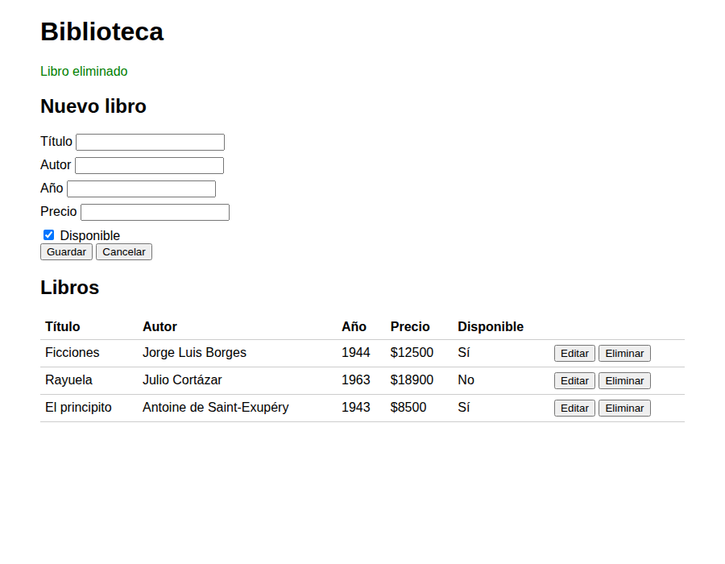
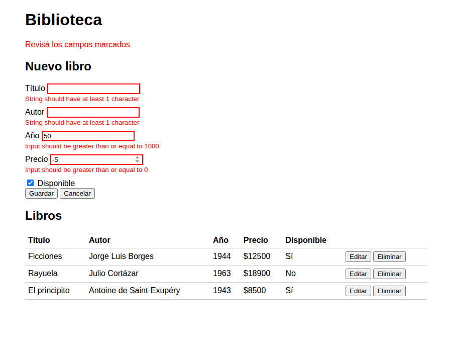
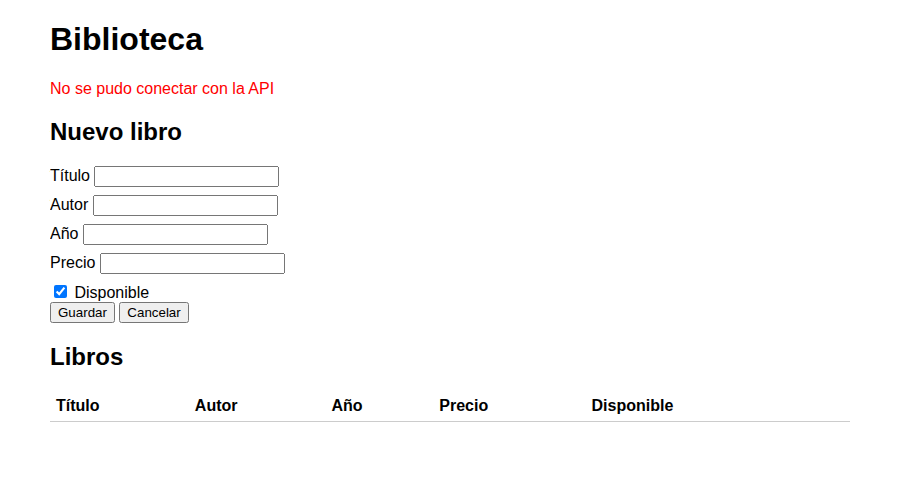
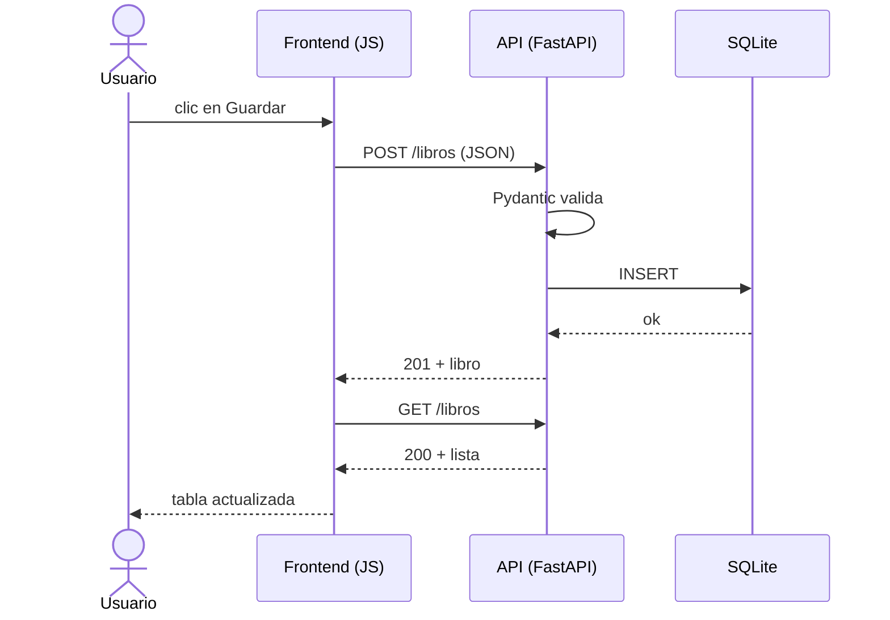
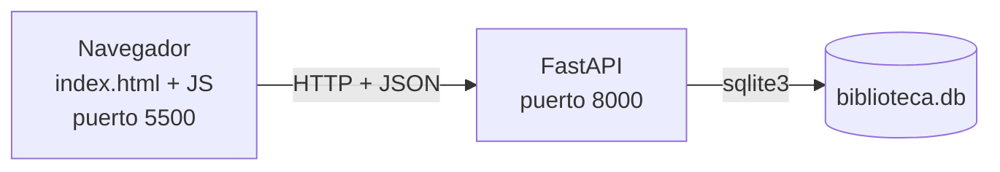
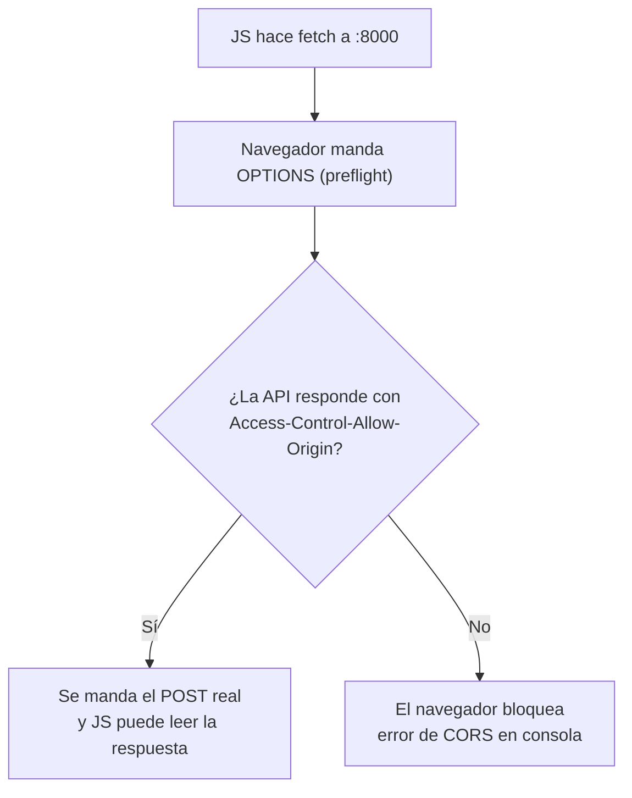

Biblioteca - TP Full Stack

Alumno: Francesco Giacosa  
Curso: 6to 5ta  
Materia: Programación

Tema del proyecto

Para este trabajo hice una aplicación de biblioteca, donde se pueden agregar, ver, editar y eliminar libros. Cada libro tiene un id, un título, un autor, un año, un precio y un campo que indica si está disponible o no.

La idea es que los libros se vean en una página web, pero que los datos se guarden en una base de datos para que no se pierdan cuando se cierre la página.

Tecnologías usadas

En el backend usé Python con FastAPI para crear la API. También usé Pydantic para revisar los datos que llegan y SQLite, con `sqlite3`, para guardarlos.

En el frontend usé HTML para la estructura de la página, CSS para los estilos y JavaScript para hacer que funcione. No usé frameworks ni librerías de JavaScript. Para comunicarme con la API uso `fetch` y para mostrar los datos uso el DOM.

Cómo ejecutar el proyecto

Primero hay que abrir el proyecto en Visual Studio Code y entrar a la carpeta del backend desde una terminal:

```bash
cd backend
python -m venv venv
```

Después hay que activar el entorno virtual. En Windows:

```bash
venv\Scripts\activate
```

En Linux o macOS:

```bash
source venv/bin/activate
```

Se instalan las dependencias y se inicia el servidor:

```bash
pip install -r requirements.txt
uvicorn main:app --reload
```

El backend queda funcionando en `http://localhost:8000`. Para ver y probar los endpoints desde el navegador se puede entrar a `http://localhost:8000/docs`, que es la documentación que genera FastAPI.

Para abrir el frontend, hay que dejar el backend funcionando, abrir otra terminal desde la carpeta principal del proyecto y ejecutar:

```bash
cd frontend
python -m http.server 5500
```

Después se entra a `http://localhost:5500`. También se puede abrir el `index.html` con Live Server desde Visual Studio Code.

Endpoints de la API

Estos son los pedidos que se pueden hacer a la API:

| Método | Ruta           | Qué hace                 | Éxito | Error     |
|---     |---             |---                       |---    |---        |
| GET    | `/libros`      | Muestra todos los libros | 200   | —         |
| GET    | `/libros/{id}` | Busca un libro por su id | 200   | 404       |
| POST   | `/libros`      | Agrega un libro          | 201   | 422       |
| PUT    | `/libros/{id}` | Edita un libro           | 200   | 404 / 422 |
| DELETE | `/libros/{id}` | Elimina un libro         | 200   | 404       |

Por ejemplo, para guardar un libro se manda un POST con los datos en formato JSON:

```
POST /libros
{"titulo": "Ficciones", "autor": "Jorge Luis Borges", "año": 1944, "precio": 12500}

→ 201
{"titulo": "Ficciones", "autor": "Jorge Luis Borges", "año": 1944, "precio": 12500.0, "disponible": true, "id": 1}
```

El código 201 indica que se creó correctamente. Además, la respuesta trae los datos del libro con su id.

Si se busca un libro con un id que no existe, la API devuelve 404:

```
GET /libros/9   → 404  {"detail": "Libro no encontrado"}
```

Capturas del frontend

Estas capturas muestran el listado de libros, cómo aparecen los errores del formulario y qué se ve cuando la API no está disponible.

| Listado | Errores de validación | API apagada |
|---|---|---|
|  |  |  |

Decisiones de diseño

Separé el backend en cuatro archivos para que no quede todo mezclado. En `main.py` están las rutas de la API, en `models.py` están los modelos de Pydantic, en `managers.py` están las consultas a la base de datos y en `database.py` está la conexión a SQLite.

En el frontend también separé las tareas. `api.js` se encarga de los pedidos con `fetch`, `ui.js` cambia lo que aparece en la página y `main.js` maneja los eventos, como hacer clic en un botón.

También decidí que los errores de los datos se revisen desde el backend. El formulario usa `novalidate` para poder mostrar debajo de cada campo los errores que manda la API con el código 422.

Los filtros por query string no están implementados en esta versión del proyecto.

Preguntas de arquitectura

1. Ciclo de vida de una petición

Cuando el usuario completa el formulario y hace clic en Guardar, pasan varias cosas hasta que el libro aparece en la tabla:

1. `main.js` toma los datos que se escribieron en el formulario usando `leerFormulario()`.
2. Después se llama a `crearLibro()` de `api.js`, que manda un POST a la API con los datos en JSON usando `fetch`.
3. FastAPI recibe el pedido y Pydantic revisa los datos con el modelo `LibroCreate`. Si hay algún dato incorrecto, responde con el error 422.
4. Si los datos están bien, se usa `Depends(get_db)` para obtener la conexión a la base de datos. Después `LibroManager.create()` guarda el libro con un `INSERT` en SQLite.
5. La API responde con el código 201 y los datos del libro que se creó.
6. Por último, el frontend muestra el mensaje "Libro guardado", vuelve a consultar la lista de libros y actualiza la tabla.

Este diagrama muestra el recorrido de ese pedido:



2. Quién es el cliente y quién es el servidor

En mi proyecto, el cliente es el navegador donde se abre la página del frontend. El servidor es el backend hecho con FastAPI, que recibe los pedidos y trabaja con la base de datos.

La diferencia con una aplicación de escritorio tradicional es que en una aplicación de escritorio normalmente el programa funciona en la misma computadora. En este caso el frontend y el backend están separados y se comunican por HTTP. Por eso, distintos usuarios podrían usar la misma API desde sus navegadores.

En el diagrama se ve cómo se conectan las partes del proyecto:



3. HTTP y códigos de estado

HTTP es el sistema que se usa para mandar pedidos entre el navegador y el servidor. Los métodos sirven para indicar qué se quiere hacer con los datos.

- GET sirve para consultar libros.
- POST sirve para crear un libro nuevo.
- PUT sirve para modificar un libro que ya existe.
- DELETE sirve para borrar un libro.

Los códigos de estado indican si el pedido salió bien o si hubo un problema. El 200 significa que salió bien, el 201 que se creó un recurso, el 404 que no se encontró lo que se buscaba y el 422 que los datos enviados no pasaron la validación.

| Operación | Método | Ruta           | Éxito | Error     |
|---        |---     |---             |---    |---        |
| Listar    | GET    | `/libros`      | 200   | —         |
| Ver uno   | GET    | `/libros/{id}` | 200   | 404       |
| Crear     | POST   | `/libros`      | 201   | 422       |
| Editar    | PUT    | `/libros/{id}` | 200   | 404 / 422 |
| Borrar    | DELETE | `/libros/{id}` | 200   | 404       |

4. CORS

La Same-Origin Policy es una regla de seguridad de los navegadores. Hace que una página no pueda leer libremente las respuestas de otro origen. Para que sea el mismo origen, tienen que coincidir el protocolo, el dominio y el puerto.

En mi proyecto el frontend funciona en el puerto 5500 y el backend en el 8000. Como tienen distintos puertos, el navegador los considera orígenes diferentes.

Para permitir la comunicación se usa `CORSMiddleware` en FastAPI. Este middleware agrega encabezados como `Access-Control-Allow-Origin`, que le indican al navegador si está permitido que el frontend lea la respuesta de la API. En algunos pedidos, el navegador primero manda un OPTIONS para comprobar los permisos y después manda el pedido real.



5. Separación de responsabilidades

Separé los endpoints de las consultas SQL porque cada parte tiene una función distinta. Los endpoints reciben los pedidos y devuelven las respuestas, mientras que `LibroManager` se ocupa de consultar, crear, editar y borrar los libros en la base de datos.

Esto sirve para tener el código más ordenado y para que, si necesito cambiar algo de la base de datos, no tenga que cambiar todas las rutas.

Con `Depends(get_db)`, FastAPI le pasa a cada pedido una conexión a SQLite y la cierra cuando termina. Si abriera conexiones todo el tiempo y en cualquier parte del código, sería más difícil controlarlas, se gastarían más recursos y podrían quedar conexiones abiertas.

6. JSON como formato de intercambio

JSON es un formato de texto que sirve para pasar datos entre el frontend y el backend. Se usa porque JavaScript puede enviarlo fácilmente y Python, por medio de FastAPI, también puede trabajar con esos datos.

Cuando la API recibe el JSON, Pydantic revisa los valores con el modelo `LibroCreate`. Por ejemplo, comprueba que el título no esté vacío y que el precio no sea negativo. Si algún dato no cumple las reglas, FastAPI responde con el código 422 y explica qué campos tienen errores.

Un ejemplo de un pedido incorrecto sería este:

```
POST /libros
{"titulo": "", "autor": "Anónimo", "precio": -5}

→ 422
{"detail": [
  {"loc": ["body", "titulo"], "msg": "String should have at least 1 character"},
  {"loc": ["body", "precio"], "msg": "Input should be greater than or equal to 0"}
]}
```

En ese caso el libro no se guarda, porque el título está vacío y el precio es menor que cero.

7. Stateless

Que HTTP sea stateless significa que el servidor no necesita recordar los pedidos anteriores para responder al siguiente. Cada pedido tiene que traer la información necesaria para poder procesarlo.

En mi aplicación, los libros quedan guardados en el archivo `biblioteca.db`, no en la memoria del servidor. Entonces, si se reinicia FastAPI, los datos siguen guardados.

Si en algún momento quisiera usar tres servidores en vez de uno, los pedidos podrían ir a cualquiera de ellos. Pero tendría que usar una base de datos compartida entre los tres, porque SQLite guarda los datos en un archivo local.
